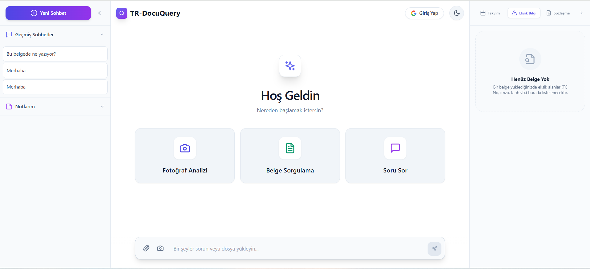
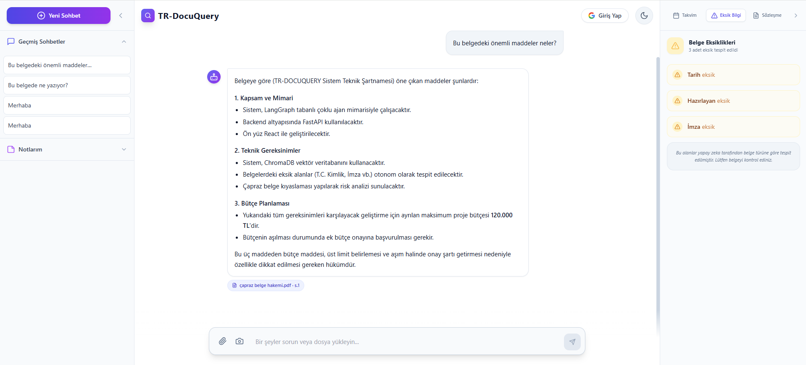
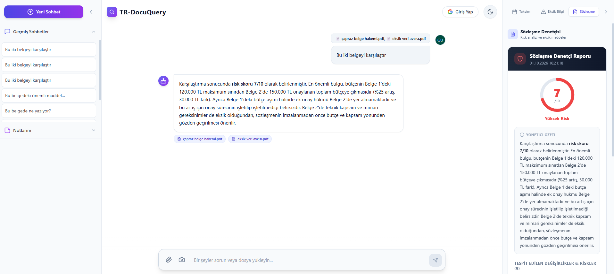
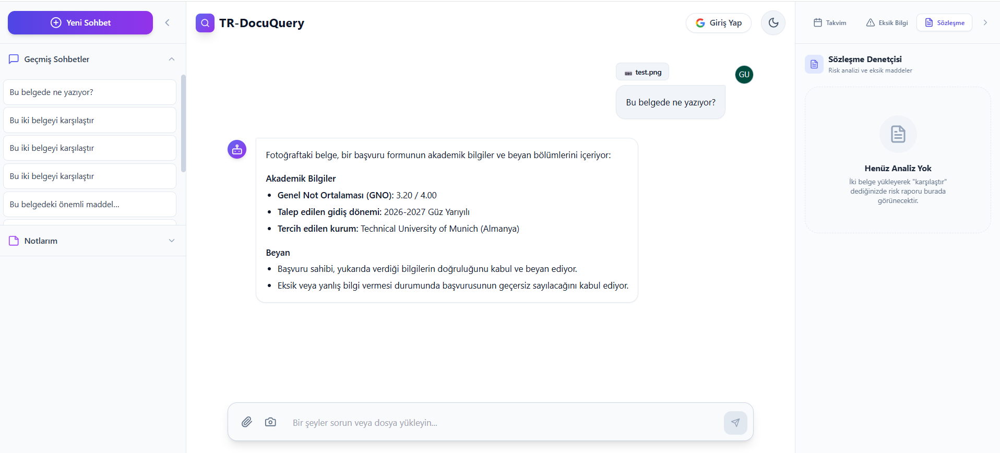
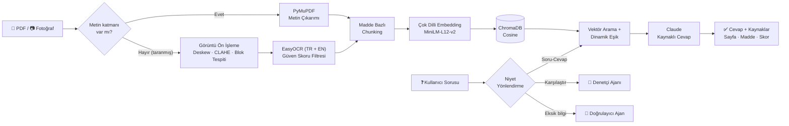

<div align="center">

# 📄 TR-Docuquery

### OCR + RAG + LLM Ajanları ile Türkçe Akıllı Doküman Sorgulama Sistemi

**TÜBİTAK 2209-A Üniversite Öğrencileri Araştırma Projeleri Destekleme Programı kapsamında desteklenmiştir.**


-D97757)


</div>

---

## 📌 Proje Hakkında

**TR-Docuquery**, taranmış veya dijital Türkçe belgeleri (sözleşmeler, dilekçeler, resmî yazılar, başvuru formları) okuyup **doğal dilde sorgulanabilir** hale getiren bir yapay zeka sistemidir.

Kullanıcı bir PDF ya da belge fotoğrafı yükler; sistem belgeyi **OCR** ile okur, **madde yapısını koruyarak** parçalara ayırır, **vektör veritabanına** indeksler ve kullanıcının sorularını **sayfa ve madde numarasıyla kaynak göstererek** yanıtlar. Bunun yanında **LangGraph** tabanlı ajanlar belgedeki eksik bilgileri tespit eder, iki belge sürümünü karşılaştırıp risk analizi yapar ve metinden görev/tarih çıkarır.

> **Gerçek örnek:** İki belge yüklenip *"Bu iki belgeyi karşılaştır"* denildiğinde sistem, bütçenin Belge 1'de **en fazla 120.000 TL** iken Belge 2'de **150.000 TL** olarak onaylandığını (%25 artış), aşım hâlinde ek onay maddesinin Belge 2'de bulunmadığını tespit edip **7/10 – Yüksek Risk** skoru üretir.

### 🙋 Benim Rolüm

Bu proje ekip çalışmasıyla geliştirilmiştir. **Ben projenin yapay zeka tarafından sorumluydum:** OCR hattı, RAG mimarisi (chunking, embedding, vektör arama), LLM entegrasyonu ve LangGraph ajanları. Web ve mobil arayüzler (`frontend/`) ekip arkadaşlarım tarafından geliştirilmiştir; bu README yapay zeka bileşenlerine odaklanır.

---

## 🖼️ Ekran Görüntüleri

<table>
  <tr>
    <td width="50%"><br/><p align="center"><b>Ana ekran</b>: fotoğraf analizi, belge sorgulama ve serbest soru</p></td>
    <td width="50%"><br/><p align="center"><b>Belgeye soru sorma</b>: kaynak etiketli cevap ve sağda eksik bilgi paneli</p></td>
  </tr>
  <tr>
    <td width="50%"><br/><p align="center"><b>Çapraz belge denetimi</b>: risk skoru ve yönetici özeti</p></td>
    <td width="50%"><br/><p align="center"><b>Fotoğraftan belge okuma</b>: OCR ile okunan metnin yorumlanması</p></td>
  </tr>
</table>

---

## 🏗️ Mimari



---

## 🧠 Yapay Zeka Bileşenleri

### 1. OCR Hattı — Görüntü Ön İşleme + EasyOCR
`ocr_engine.py`

EasyOCR'ı doğrudan kullanmak yerine, fotoğrafla çekilmiş ve taranmış belgelerde doğruluğu artırmak için önüne **özel bir görüntü işleme hattı** kuruldu:

| Adım | Yöntem | Amaç |
|---|---|---|
| **Yamukluk düzeltme** | `minAreaRect` ile eğim açısı tespiti + afin dönüşüm | Eğik çekilmiş belgeleri düzeltmek |
| **Gölge temizleme** | LAB renk uzayında yalnızca L kanalına **CLAHE** | Renkleri bozmadan aydınlatma farklarını gidermek |
| **Metin bloğu tespiti** | Otsu eşikleme + yatay dilation + kontur analizi | Satırları ayrı ayrı, yukarıdan aşağı okumak |
| **Güven filtresi** | Güven skoru < 0.4 olan sonuçları eleme | Gürültüyü metne karıştırmamak |
| **Otomatik yeniden deneme** | Sonuç boşsa agresif CLAHE + keskinleştirme | Zor görüntülerde ikinci şans |

Her OCR sonucu `{text, confidence, warning}` olarak döner; düşük güvenli okumalarda kullanıcı uyarılır.

### 2. Hibrit PDF Okuma
`pdf_reader.py`

Her sayfa önce **PyMuPDF** ile konum sıralı (`sort=True`) okunur. Metin katmanı olmayan ya da çok az metin içeren sayfalar (taranmış PDF) otomatik olarak **300 DPI görüntüye çevrilip OCR hattına** gönderilir. Her sayfanın hangi yöntemle okunduğu (`text` / `ocr`) metadata'da saklanır.

### 3. Madde Bazlı (Yapısal) Chunking
`process_documents.py`

Hukuki belgelerde anlam birimi **maddedir**. Metni sabit uzunlukta kesmek yerine:

- `MADDE 6 – FESİH` / `BÖLÜM 2` başlıkları regex ile tespit edilir; **her madde ayrı bir chunk** olur.
- Metin içindeki atıflar (*"Madde 5'te belirtilen…"*, *"…Madde 7 uyarınca"*) **yeni madde sanılmaz**.
- Madde başlığı otomatik ayrıştırılır (satır sonu, BÜYÜK HARF veya iki nokta biçimleri).
- Uzun maddeler alt parçalara bölünür ve **her parçaya madde başlığı eklenir** — embedding modelinin token sınırında bağlam kaybolmaz.
- İlk maddeden önceki metin (taraflar, giriş) ve önceki sayfadan devam eden metin kaybolmaz.
- Madde bulunmayan belgelerde **paragraf + overlap** tabanlı, kelime ortasından kesmeyen klasik chunking uygulanır.

Her chunk; `kaynak dosya`, `sayfa`, `madde no`, `madde başlığı`, `okuma yöntemi` metadata'sı ile saklanır.

### 4. Embedding ve Vektör Arama
- **Model:** `paraphrase-multilingual-MiniLM-L12-v2` (Türkçe dahil 50+ dil)
- **Veritabanı:** ChromaDB (kalıcı, cosine benzerliği), toplu (batch) embedding
- **Dinamik eşik:** Sabit bir benzerlik eşiği yerine, en iyi sonucun skoruna göre ayarlanan eşik kullanılır. Böylece alakasız parçalar LLM'e gönderilmez.
- Dosya bazlı filtreleme (tek veya çoklu belge içinde arama)

### 5. Kaynaklı Cevap Üretimi (Grounded Generation)
LLM olarak **Claude (Anthropic)** kullanılır. Halüsinasyonu azaltmak için:
- Model **yalnızca verilen bağlamdan** cevap vermeye yönlendirilir; bilgi yoksa *"belgelerde bulunamadı"* der.
- Cevabın altında hangi **belge, sayfa ve maddeden** geldiğini gösteren **kaynak etiketleri** yer alır.
- Kullanıcıya her kaynağın **dosya, sayfa, madde ve benzerlik skoru** döndürülür.

### 6. LangGraph Ajanları
`agent/`

| Ajan | Graf Yapısı | Görevi |
|---|---|---|
| **Eksik Bilgi Doğrulayıcı** <br/>`missing_info_agent.py` | `START → validate_document → END` | Belge türünü tahmin eder (Dilekçe, Fatura, Kira Sözleşmesi…), o tür için zorunlu alanlardan eksik olanları (*TC Kimlik No, IBAN, Tarih, İmza*…) okunabilir Türkçe adlarla listeler. Fotoğrafı çekilmiş tek bir bölümde, yalnızca o bölüme ait alanları değerlendirir. |
| **Çapraz Belge Denetçisi** <br/>`cross_document_auditor.py` | `START → compare_documents → generate_summary → END` | İki belge sürümündeki değişen maddeleri, fiyat/tarih tutarsızlıklarını ve eksik bölümleri bulur; **1–10 risk skoru** ve yönetici özeti üretir. |
| **Görev Çıkarıcı** <br/>`graph_builder.py` · `task_extractor.py` | `START → analiz_node → END` (timeout korumalı) | Metinden görevleri, sorumluları, son tarihleri ve konuları çıkarır; takvime eklenebilir. |
| **Proaktif Araştırma Ajanı** <br/>`proactive_graph.py` | `analiz →(koşullu)→ arama → bildirim` | Sohbet geçmişinden kullanıcının ilgi alanlarını çıkarır, **koşullu kenar** ile gerekiyorsa web'de arar ve sonuçları özetler. Aynı konunun tekrar tekrar aranmaması için **benzerlik tabanlı cooldown** içerir. |

Tüm ajanlarda:
- **Pydantic şemaları ile structured output** (serbest metin parse etmek yerine tipli çıktı)
- **Tenacity** ile geçici API hatalarında üstel beklemeli yeniden deneme
- Hata durumunda çökmeden `error` alanı dolduran **graceful degradation**

### 7. Niyet Yönlendirme (Intent Routing)
`api.py → /sor`

Tek bir sohbet kutusundan gelen istek, içeriğine göre otomatik olarak doğru yola gönderilir:

| Kullanıcı ne yazdı? | Sistem ne yapar? |
|---|---|
| *"karşılaştır"*, *"farkları bul"*, *"riskler"* + 2 belge | **Denetçi ajanı** çalışır, risk raporu sağ panelde açılır |
| *"özetle"*, *"belge ne anlatıyor"* | **Özet modu**: küçük belgelerde tüm parçalar modele verilir |
| Belgeye özel soru | **RAG**: vektör arama + kaynaklı cevap |
| *"Merhaba"* gibi belgeden bağımsız mesaj | **Genel sohbet modu**: gereksiz arama ve eksik bilgi analizi yapılmaz |

### 8. BERTurk ile Maskeli Kelime Tamamlama (Deneysel)
`ai_corrector.py`

OCR'ın okuyamadığı kelimeler `[MASK]` ile işaretlenip **BERTurk** (`dbmdz/bert-base-turkish-cased`) ile bağlama göre tamamlanır. Birden fazla maske soldan sağa sırayla doldurulur.

---

## 🛠️ Teknoloji Yığını

| Katman | Teknolojiler |
|---|---|
| **OCR & Görüntü İşleme** | EasyOCR, OpenCV, PyMuPDF |
| **Embedding & NLP** | Sentence-Transformers, Hugging Face Transformers, BERTurk |
| **Vektör Veritabanı** | ChromaDB |
| **LLM & Ajanlar** | Claude (Anthropic API), LangChain, LangGraph, Pydantic |
| **Backend** | FastAPI, Uvicorn |
| **Web Arayüzü** | React, TypeScript, Vite, Tailwind CSS *(ekip)* |
| **Demo Arayüzü** | Streamlit |
| **Diğer** | Tenacity, DuckDuckGo Search, Google Calendar API |

---

## 📂 Proje Yapısı

```
TR-Docuquery/
├── api.py                      # FastAPI sunucusu (OCR + RAG + ajan endpoint'leri)
├── ocr_engine.py               # Görüntü ön işleme + EasyOCR hattı
├── pdf_reader.py               # Hibrit PDF okuma (metin katmanı + OCR fallback)
├── process_documents.py        # Madde bazlı chunking + embedding + ChromaDB indeksleme
├── rag_demo.py                 # Streamlit RAG demo arayüzü
├── demo.py                     # Komut satırından PDF yükleme + soru sorma
├── karsilastir.py              # Komut satırından iki belgeyi karşılaştırma
├── ai_corrector.py             # BERTurk maskeli kelime tamamlama (deneysel)
├── agent/
│   ├── llm_config.py           # Merkezi LLM yapılandırması
│   ├── missing_info_agent.py   # Eksik bilgi doğrulayıcı ajan
│   ├── cross_document_auditor.py # Çapraz belge denetçisi ajan
│   ├── graph_builder.py        # Görev çıkarım grafı (timeout korumalı)
│   ├── task_extractor.py       # Görev / tarih / konu çıkarımı
│   ├── proactive_graph.py      # Proaktif araştırma ajanı
│   ├── chat_analyzer.py        # Sohbetten ilgi alanı çıkarımı
│   └── web_searcher.py         # Web araması + özetleme
├── smoke_test.py               # Uçtan uca API testleri
├── test_validator.py           # Doğrulayıcı ajan testi
├── test_auditor.py             # Denetçi ajan testi
├── documents/                  # Örnek test belgeleri
├── docs/images/                # README ekran görüntüleri
└── frontend/                   # Web arayüzü — React + Vite (ekip)
```

---

## 🚀 Kurulum

**Gereksinimler:** Python 3.10+ ve bir [Anthropic API anahtarı](https://console.anthropic.com)

```bash
git clone https://github.com/MuhammetDikmetas/TR-Docuquery.git
cd TR-Docuquery

python -m venv venv
# Windows:
venv\Scripts\activate
# macOS / Linux:
source venv/bin/activate

pip install -r requirements.txt
```

Proje klasöründe bir `.env` dosyası oluşturun (`.env.example` dosyasını kopyalayabilirsiniz):

```env
ANTHROPIC_API_KEY=sk-ant-...
ANTHROPIC_MODEL=claude-sonnet-5-5
```

### Çalıştırma

**1) Backend (API sunucusu)**

```bash
python api.py
```

Sunucu `http://127.0.0.1:8000` adresinde açılır, etkileşimli dokümantasyon `/docs` altındadır.

**2) Web arayüzü** (ikinci bir terminalde)

```bash
cd frontend
npm install
npm run dev
```

Tarayıcıda `http://localhost:3000` adresini açın. PDF veya fotoğraf yükleyip doğrudan soru sorabilirsiniz; giriş yapmadan misafir olarak kullanılabilir.

**3) Diğer yollar**

```bash
# Streamlit RAG demosu
python process_documents.py     # documents/ klasöründeki PDF'leri indeksler
streamlit run rag_demo.py

# Ajanları tek başına denemek
python -m agent.task_extractor
python test_validator.py
```

> İlk çalıştırmada EasyOCR ve embedding modelleri otomatik indirilir (birkaç dakika sürebilir).

---

## 🔌 Yapay Zeka Endpoint'leri

| Metot | Endpoint | Açıklama |
|---|---|---|
| `POST` | `/yukle` | PDF yükler → OCR → madde bazlı chunking → ChromaDB'ye indeksler |
| `POST` | `/sor` | Belgelere soru sorar; niyete göre RAG, denetçi veya doğrulayıcıya yönlendirir |
| `POST` | `/sor/fotograf` | Belge fotoğrafını OCR ile okur ve soruyu cevaplar |
| `POST` | `/agent/validate-document` | Eksik bilgi doğrulayıcı ajan |
| `POST` | `/agent/audit-documents` | İki belgeyi karşılaştırır, risk skoru üretir |
| `POST` | `/agent/task-extract` | Metinden görev ve tarih çıkarır |
| `POST` | `/agent/proactive-search` | Sohbetten ilgi alanı çıkarıp web'de araştırır |

Tüm endpoint'lerin etkileşimli dokümantasyonu sunucu çalışırken `http://127.0.0.1:8000/docs` adresindedir.

---

## 🧪 Testler

`smoke_test.py`, çalışan sunucuya karşı uçtan uca 7 senaryo çalıştırır: sunucu sağlığı, boş/geçersiz girdilerde hatasız davranış, bozuk görüntüde OCR uyarısı, belge doğrulayıcının pozitif/negatif testleri, LangGraph ajan yapısı ve cooldown mekanizması.

```bash
python api.py          # 1. terminal
python smoke_test.py   # 2. terminal
```

---

## 🗺️ Yol Haritası

- [ ] Tablo içeren belgeler (fatura, teklif) için Docling / LlamaParse ile gelişmiş tablo çıkarımı
- [ ] Cross-encoder ile yeniden sıralama (reranking)
- [ ] Türkçe hukuki metinlerle RAG değerlendirme seti (retrieval doğruluğu, cevap sadakati)
- [ ] BERTurk düzelticisinin OCR hattına entegrasyonu

---

## 🙏 Teşekkür

Bu çalışma, **TÜBİTAK 2209-A Üniversite Öğrencileri Araştırma Projeleri Destekleme Programı** kapsamında desteklenmiştir. Desteği için TÜBİTAK'a ve **Harran Üniversitesi Bilgisayar Mühendisliği Bölümü**'ne teşekkür ederiz.

---

## 📬 İletişim

**Muhammet Dikmetaş** — Yapay Zeka Mühendisi (LLM · NLP · RAG)

[](https://www.linkedin.com/in/muhammet-dikmetaş-3b55b7252/)
[](https://github.com/MuhammetDikmetas)
[](mailto:muhammetdikmetas756@gmail.com)